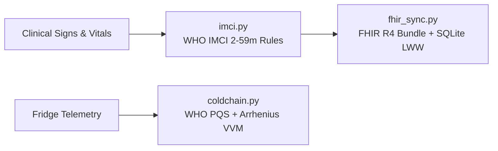

# clinicflow-lite

[](https://github.com/codesphere-u/clinicflow-lite/actions/workflows/ci.yml)
[](LICENSE)
[](pyproject.toml)
[](pyproject.toml)

**Offline-first rural clinic WHO IMCI deterministic pediatric triage engine, WHO PQS vaccine cold-chain freeze/heat excursion & Arrhenius VVM analyzer, and FHIR R4 SQLite LWW sync node.**

- **Mission Domain:** Healthcare & Medical Technology
- **Stack:** Pure Python 3.11+ (zero runtime third-party dependencies, `mypy --strict`, `ruff`, `pytest`)
- **Maintainer:** Codesphere Innovations (U) Limited (`codesphere-u`)

---

## Problem Solved

Rural Level II/III health clinics and community health workers face daily power and 3G outages where JVM-based EHR stacks cannot run, while solar vaccine-fridge freeze/heat excursions silently spoil life-saving vaccines.

## Key Features

- WHO IMCI (2–59 months) deterministic decision support covering General Danger Signs, age-stratified respiratory rates (`<12m >=50`, `12-59m >=40`), dehydration Plans A/B/C, fever/malaria/meningitis, and MUAC/edema malnutrition (`SAM`/`MAM`) with transparent rule traces.
- WHO PQS vaccine cold-chain excursion guard detecting continuous freeze alarms (`<=-0.5°C` for `>=60m`), continuous heat alarms (`>8°C` for `>=10h`), and Arrhenius kinetic degradation across `VVM2`, `VVM7`, `VVM14`, and `VVM30`.
- Standards-compliant FHIR R4 Bundle generator (`Patient`, `Encounter`, LOINC-coded `Observation`, `DetectedIssue`) backed by an offline SQLite WAL Last-Write-Wins sync store.

## Architecture Overview



See [docs/architecture.md](docs/architecture.md) for module-level design details.

## Installation

```bash
git clone https://github.com/codesphere-u/clinicflow-lite.git
cd clinicflow-lite
uv sync --extra dev
```

Or install in editable mode with standard `pip`:

```bash
pip install -e ".[dev]"
```

## Quick Start (CLI)

```bash
clinicflow-lite demo
```

## Quick Start (Python API)

```python
from clinicflow_lite import ImciAssessmentInput, classify_imci

res = classify_imci(ImciAssessmentInput(age_months=10, cough_or_difficult_breathing=True, respiratory_rate_bpm=56))
assert res.overall_priority.value == "yellow_outpatient_treatment"
```

## Testing & Quality Gates

```bash
uv run ruff check src tests
uv run mypy src
uv run pytest -v
```

## Security, Contributing & Roadmap

- **Security:** See [SECURITY.md](SECURITY.md) for responsible disclosure procedures.
- **Contributing:** See [CONTRIBUTING.md](CONTRIBUTING.md) and [CODE_OF_CONDUCT.md](CODE_OF_CONDUCT.md).
- **Changelog & Roadmap:** See [CHANGELOG.md](CHANGELOG.md) and [ROADMAP.md](ROADMAP.md).

## License

MIT License — see [LICENSE](LICENSE).

## Support & Contact

Open an issue on [GitHub Issues](https://github.com/codesphere-u/clinicflow-lite/issues) or contact `codesphereinnovationz@gmail.com`.
